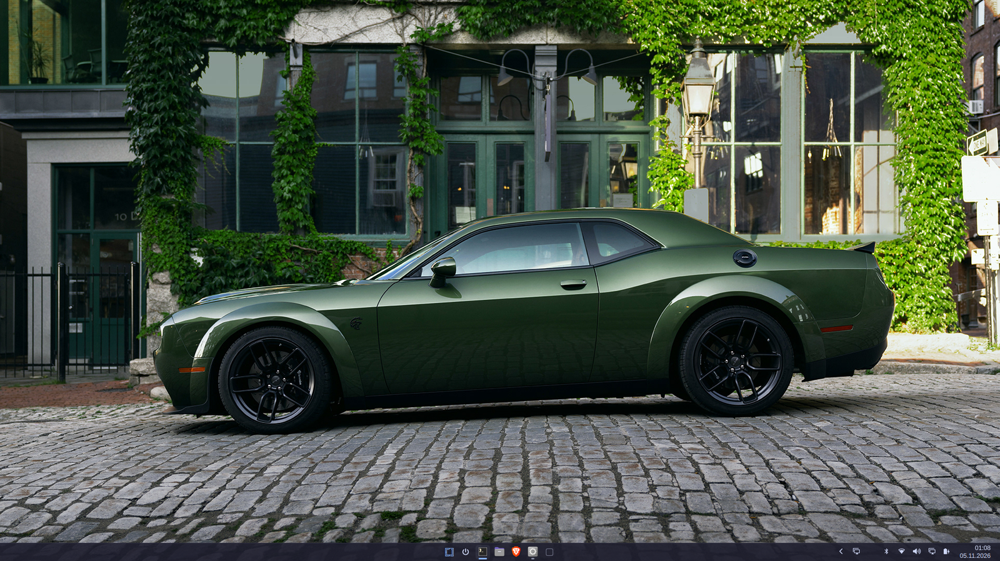
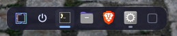
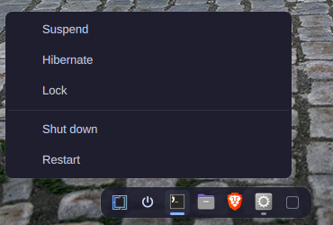
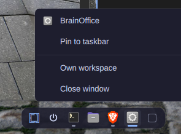
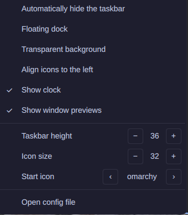

# Taskbarchy

A Windows 11 style taskbar for the [Omarchy](https://omarchy.org/) shell
(Quickshell + Hyprland).

A fork of [maximxmoroz.win11-dock](https://github.com/maximxmoroz/omarchy-windows-dock)
(MIT): a Windows 11 style taskbar that is mutually exclusive with the Omarchy
bar. Hiding the bar brings the taskbar up with a live mirror of the bar's
right-hand widgets; an Omarchy logo button in the bar brings the bar back and
lowers the taskbar. It reads the same settings file as the original,
`~/.config/omarchy/win11-dock.json`.



*Taskbarchy with the Omarchy bar hidden: the bar's right-hand widgets — tray, displays, bluetooth, network, audio, monitors, power — mirrored live beside the clock. The logo button in the Omarchy bar swaps back.*

<p align="center">
  
  
  
  
</p>

*Floating dock mode, the power menu, an app menu offering "Own workspace", and the dock's right-click settings menu.*

- Centered (or left-aligned) icons with a Start button
- Optional power button beside Start: Suspend, Hibernate (only when the machine supports it), Lock, Shut down, Restart — gated the same way as the Omarchy root menu
- Pinned apps each open on their own workspace: the first app you launch takes `workspaceBase`, each later app the next workspace without windows
- Mutually exclusive with the Omarchy bar: the switch button on the right shows the Omarchy bar and lowers the taskbar, and the Omarchy logo button Taskbarchy puts in the bar (left of your workspaces) hides the bar and raises the taskbar. Any other way of toggling the bar (`omarchy toggle bar`, settings, keybinds) swaps the two the same way
- While the taskbar is up (bar hidden): the bar's right-hand widgets (tray, network, audio, bluetooth, power, and anything else you have configured) render beside the clock — the real widgets, with live status, opening the same panels above the taskbar
- Running apps get a small pill, the focused app a wide accent pill
- Hover a running app for live window thumbnails; click one to focus it, ✕ to close it
- Drag pinned icons left and right to reorder them
- Right-click an app: its desktop actions, new window, pin/unpin, reorder, close — plus "Own workspace" when it shares a workspace with another app, which silently moves its windows to an empty workspace
- Right-click a window preview: "Own workspace" moves just that one window to an empty workspace, so the app shows up as a second icon there; "Close window" does what it says
- An app with windows on different workspaces gets one icon per workspace, each with its own previews
- Right-click the bar: auto-hide, floating dock, alignment, clock, previews, transparent background, bar height, icon size and Start icon
- Full-width taskbar or a floating rounded dock
- Follows the Omarchy theme, or use the stock Windows 11 dark/light colors
- English and Russian menus (picked from the system locale)

## Install

```bash
omarchy plugin add https://github.com/Xenobones/taskbarchy.git --enable
```

Enabling Taskbarchy automatically disables the original
`maximxmoroz.win11-dock` if it is installed (the manifest declares it as the
clone source), so you won't end up with two docks.

To get the logo button in the Omarchy bar — the one that swaps the bar for
the taskbar — put the widget in the bar's left section, where the built-in
menu button usually sits:

```bash
omarchy bar put xenobones.taskbarchy --section left --index 0
```

If you had `omarchy.menu` there, remove that entry from `bar.layout.left` in
`~/.config/omarchy/shell.json` (the root menu stays one reach away: Super,
Super+Space, the taskbar Start button, or a right-click on the logo).

## Setting up a new machine

The plugin carries everything over — the bar/taskbar swap, the mirrored
right-section widgets, the logo widget — but a few pieces are machine-local
and need redoing:

1. **Install and put the logo button in the bar** (the two commands above).
2. **Pinned apps and dock settings**: copy `~/.config/omarchy/win11-dock.json`
   from the old machine, or just re-pin apps there — defaults regenerate on
   first run.
3. **Super-tap for the root menu** (optional): add release binds to
   `~/.config/hypr/bindings.lua` so tapping and releasing Super opens the
   menu:

   ```lua
   o.bind("SUPER + SUPER_L", "Omarchy menu (tap Super)", "omarchy-menu toggle", { release = true })
   o.bind("SUPER + SUPER_R", "Omarchy menu (tap Super)", "omarchy-menu toggle", { release = true })
   ```

4. **Widget plugins** (optional): the taskbar mirrors whatever that machine's
   `bar.layout.right` lists, so install extras like `better.displays`
   individually if you want the same icons.
5. **Frosted background** (optional): the Hyprland layer rule from
   [Frosted background](#frosted-background) below.

## Update

```bash
omarchy plugin update xenobones.taskbarchy
```

## Uninstall

```bash
omarchy plugin remove xenobones.taskbarchy
rm -f ~/.config/omarchy/win11-dock.json   # optional: drop your dock settings
```

## Requirements

Omarchy 4 (Quattro) on Hyprland. Nothing extra to install — everything the
dock calls ships with Omarchy or systemd:

- `uwsm-app`, `gtk-launch`: launching pinned apps
- `gsettings`: pinning and desktop-entry lookups
- `omarchy` CLI (`toggle bar`, `system lock|shutdown|reboot`), `omarchy-menu`,
  `omarchy-launch-editor`, `omarchy-shell`: shell integration and the power menu
- `systemctl suspend` / `systemctl hibernate`: the power menu's sleep entries
- `omarchy-hibernation-available`, `omarchy-toggle-enabled`: read-only checks
  that decide whether Hibernate and Suspend are offered in the power menu
- Hyprland IPC (through Quickshell): workspace focus and silent window moves

The only file it writes is its own `~/.config/omarchy/win11-dock.json` (shared
with the original maximxmoroz.win11-dock by design, and created with defaults
on first run). It never touches `~/.config/omarchy/shell.json` — putting the
logo widget into the bar is an explicit `omarchy bar put` command you run
yourself.

## Usage

| Action | Result |
|---|---|
| Left click | Launch the app, or focus it. Clicking the focused app steps through its windows |
| Middle click | Open a new window |
| Drag sideways | Reorder a pinned app |
| Right click on an app | App menu |
| Right click on a window preview | That window's menu: Own workspace, Close window |
| Right click on the bar | Dock settings |
| Click anywhere outside a menu | Closes the menu |
| Hover | Window previews (name tooltip when the app isn't running) |

## Configuration

Settings live in `~/.config/omarchy/win11-dock.json` and apply on save. The
right-click menu on the bar edits the same file.

| Key | Default | |
|---|---|---|
| `pinned` | `[]` | Desktop entry ids without `.desktop`, left to right |
| `pinnedWorkspaces` | `true` | Launch each pinned app on the next workspace with no windows |
| `workspaceBase` | `1` | First workspace considered; later launches fill the ones after it |
| `floating` | `false` | Rounded dock around the icons instead of a full-width bar |
| `autoHide` | `false` | Slide away; touch the bottom screen edge to bring it back |
| `alignment` | `"center"` | `"center"` or `"left"` |
| `colorScheme` | `"theme"` | `"theme"` (Omarchy theme), `"dark"` or `"light"` (Windows 11 colors) |
| `barHeight` | `48` | Bar height in px |
| `iconSize` | `26` | Icon size in px |
| `opacity` | `0.9` | Bar background opacity |
| `transparent` | `false` | No background and no edge line, only the icons |
| `showStart` | `true` | Show the Start button |
| `showPower` | `true` | Show the power button (Shut down / Restart) |
| `startCommand` | `"omarchy-menu toggle apps"` | Shell command the Start button runs |
| `startIcon` | `"omarchy"` | `"omarchy"`, `"windows"`, `"arch"`, `"linux"`, `"grid"`, or any icon name / absolute image path |
| `showClock` | `true` | Clock on the right (full-width bar only) |
| `showBarToggle` | `true` | Button on the right that shows the Omarchy bar (and lowers the taskbar) |
| `showBarTools` | `true` | Mirror the Omarchy bar's right-hand widgets beside the clock while the bar is hidden |
| `showPreviews` | `true` | Hover previews and tooltips |
| `fontFamily` | `"sans-serif"` | Font for labels |

### Frosted background

For the mica look, turn on blur in Hyprland and add a layer rule to
`~/.config/hypr/looknfeel.lua`, then lower `opacity` to taste:

```lua
hl.layer_rule({ match = { namespace = "win11-dock" }, blur = true, ignore_alpha = 0.3 })
```

### Keybinds / scripting

```bash
omarchy-shell win11-dock toggleAutoHide
omarchy-shell win11-dock toggleFloating
omarchy-shell win11-dock pin org.gnome.Nautilus
omarchy-shell win11-dock unpin org.gnome.Nautilus
```

## Development

`Dock.qml` owns the config, the app model and the mirrored-bar-widget catalogue
lookup, `Taskbar.qml` is the bar window with its popups, `TaskButton.qml` is one
app button, `BarAdapter.qml` stands in for the Omarchy bar host so real bar
widgets can render in the taskbar, `BarWidgetHost.qml` loads one widget from
the shell's catalogue, and `BarSwitchButton.qml` is the logo widget that swaps
the Omarchy bar for the taskbar. The shell hot-reloads the entry file, but
edits to the other QML files only show up after `omarchy restart shell`.

### Known limitations

- The taskbar and the Omarchy bar are mutually exclusive — hiding the bar
  always raises the taskbar and vice versa, whatever flipped the toggle. To
  run with neither, disable the plugin.
- The mirrored widgets are live instances of the shell's own bar widgets, so a
  widget that hides itself in the bar (for example Agents before its first
  usage scan) is hidden in the taskbar too.
- Panel hotkeys and `omarchy-shell <widget> toggle` route to the Omarchy
  bar's own instances (Quickshell keeps the first handler registered per
  target), so panels they open anchor to the bar — at the top of the screen
  while the bar is hidden. Clicking the icons in the taskbar opens panels
  above the taskbar.

## Changelog

See [CHANGELOG.md](CHANGELOG.md) for release notes.

## Disclaimer

Not affiliated with or endorsed by Microsoft. "Windows" and the Windows logo
are trademarks of Microsoft Corporation, referenced here only to describe a
visual style. Omarchy and Quickshell are separate projects by their own
authors.

## License

MIT
